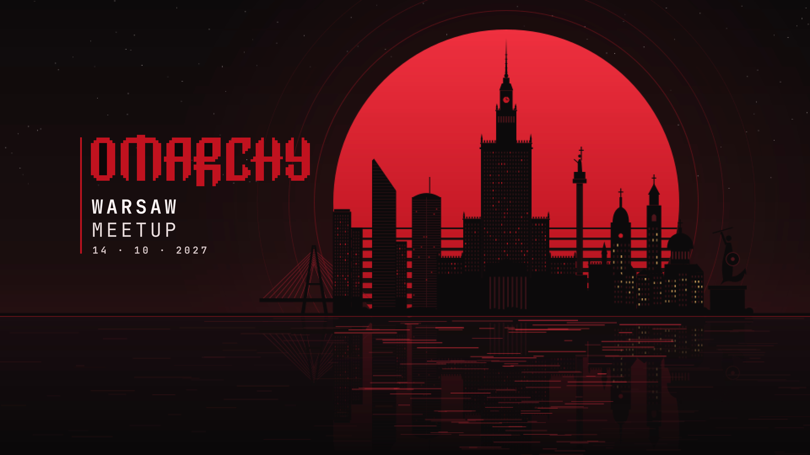

# Warsaw Meetup — Omarchy theme

A black and dark-red Omarchy theme made for the Omarchy Warsaw Meetup (14 · 10 · 2027). The main background is a pixel-art Warsaw skyline against a red sun over the Vistula.



## Install

From the Omarchy menu: **Install → Theme**, then paste this repo's URL.

Or from a terminal:

```bash
omarchy-theme-install https://github.com/pstrzalk/omarchy-warsaw-meetup-theme
```

The theme then shows up as `warsaw-meetup` in the theme picker.

## On the skyline

Świętokrzyski Bridge · Złota 44 · Palace of Culture and Science · Sigismund's Column · Old Town · Warsaw Mermaid · Vistula

## What's included

- `colors.toml`: the palette (Omarchy generates the terminal, bar and border colours from it)
- `icons.theme`: the `Yaru-red-dark` icon set
- `unlock.png`: the lock-screen logo
- `backgrounds/` (all 3840 × 2160):
  - `0-meetup-poster.jpg`: pixel-art Warsaw skyline against a red sun (default)
  - `1-warsaw-skyline.jpg`: night skyline with stars
  - `2-fourteen-october.jpg`: the meetup date
  - `3-omarchy.png`: red pixel Omarchy wordmark
